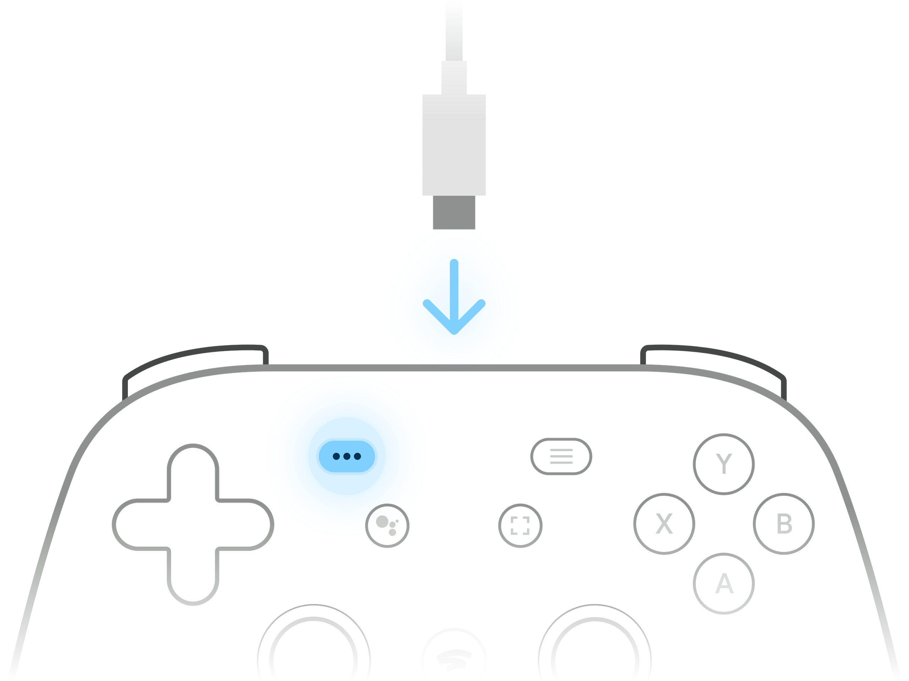

# Stadia 手柄：刷成 Xbox 手柄的自定义固件

给 Google Stadia 手柄换一套自己编译的固件，让它在 Windows 上被直接识别成 Xbox 手柄，同时修掉原厂的几个毛病。

## 这个固件做了什么

| 特性 | 说明 |
|---|---|
| **Xbox 兼容** | 有线走 XUSB（`045E:028E`），蓝牙走 Xbox Series 的 HID 协议。Windows 自带驱动直接认，不需要第三方驱动、Steam Input 或映射软件。按键、摇杆、扳机、双马达手感全部保留原厂采样。 |
| **蓝牙震动修复** | 原厂固件在蓝牙模式下完全没有震动，Windows / Android / iOS 都一样。修复后无线震动恢复，有线和原来一致。 |
| **1000Hz 回报率** | 有线模式可在 250 / 500 / 1000 Hz 之间切换，用 `Stadia + 方向键上/下` 切换、震动强弱提示档位，档位关机后保留。实测 249.9 / 500.0 / 995.2 Hz。 |

前提：PVT 量产机（序列号不是 `91`–`94` 开头）。刷写会永久烧掉芯片的签名熔丝，不可逆，但原厂固件随时可以刷回。

---

## 原理

三部分各自展开，下面每张思维导图对应一个问题。

### 1. 原厂的蓝牙为什么不震动

震动通道本身是好的——USB 有线一直能震，两条路径最后都落到同一个马达处理函数。问题出在固件向主机公布的能力清单上：

震动输出特征（UUID `0x2A4D`，报告 ID 5）的属性字节是 `0x0A`，即「可读 + 可带响应写入」，漏掉了 **Write Without Response**（无响应写入，`0x04`）。Windows 的 `hid_write()` 走蓝牙时用的恰好是无响应写入，于是主机发出的震动报告被退回，马达一声不响。

修复只改了镜像里**一个字节**：`0xCB28C` 处 `0x0A` → `0x0E`。不改指令、不重新编译，原有的特征注册代码读这个字节就会多声明一个属性位。

### 2. 自定义固件是怎么刷进去的

芯片是 i.MX RT1060，出厂开着 HAB 安全启动，只肯运行带 RSA-4096 签名的镜像。自己改过的固件没有有效签名，写进去也起不来，所以要先过两道关：

**第一关，解除签名校验。** 芯片的 SDP 串行下载模式本来用于产线和维修，它在 HAB 关闭状态下仍然可用。该模式的 USB HID 回调有个 3 字节越界写（报告缓冲区按 `+3` 偏移写入），溢出正好落在相邻的 SDP 设备结构指针上。借它可以在 BootROM 退出前执行未签名代码，永久模式则是直接把 `FIELD_RETURN` eFuse 烧掉，之后芯片进入 field return 状态，可以启动任何未签名镜像。

**第二关，写入 Flash。** 用官方刷写包里的 `restricted_ivt_flashloader.bin` 把芯片带进 Flashloader，回读 MCU 和 Flash 厂商型号（`17c8` Giga / `17ef` Winbond），选对应的 FlexSPI 配置块，按 16 KB 扇区擦除后分块写入 Application A 分区（`0x60040000`），最后复位从新固件启动。

### 3. Xbox 固件和 1000Hz 是怎么实现的

不重写整机固件。采样、摇杆校准、马达驱动这些**原厂代码全部保留**，只替换「对外说话」的那一层——身份标识、USB 描述符、HID 报告格式。

- **USB**：公布 Xbox 360 的设备标识，端点仍用原来的 `0x83` / `0x03`，把 11 字节的 Stadia HID 报告编码成 20 字节的 XUSB 报告；游戏发来的震动命令再翻译回原厂的报告 ID 5。
- **蓝牙**：换上 Xbox Series 的 283 字节 Report Map 和 PnP ID，输入用 16 字节报告、输出用 8 字节报告，同样回译给原厂马达处理函数。
- **1000Hz**：手柄的 USB 硬件本身完全够快——原厂固件把输入端点 `bInterval` 设成 6（高速 USB 下即 4 ms，250 Hz），加上固件内部对小幅摇杆变化还有一道过滤门槛，实际常只有 125 Hz。这个限制纯粹是官方固件的配置，不是硬件上限。改法是同时调整三处：把 `bInterval` 改小、把输入任务采样周期改成 2 ms 或 1 ms、把模拟输入的时间门槛从 `2×period−1` 收到 `period−1`，三者对齐后回报率才能真正上去。

---

# 操作部分

以下是把上面这些实际做一遍的完整步骤。

运行环境：Linux。命令按 Ubuntu/Debian 写，其他发行版换包管理器即可。

## 1. 安装依赖

```bash
sudo apt install -y python3 python3-venv python3-pip build-essential pkg-config \
                    libudev-dev libusb-1.0-0
```

两个工具各建自己的虚拟环境。

**签名绕过工具**

```bash
cd nxp-sdp-overrun
python3 -m venv .venv
.venv/bin/pip install hidapi keystone-engine
```

装了 `uv` 的话可以跳过这三步，后面直接 `sudo uv run main.py --permanent`。

**刷写工具**

```bash
cd ../StadiaController-main/stadiatool
python3 -m venv .venv
.venv/bin/pip install pyusb
```

`pyusb` 需要系统的 `libusb-1.0.so.0`，上面已经装好。

## 2. 权限

访问 USB 设备要 root，后面的命令统一加 `sudo`。

两个工具都需要：`nxp-sdp-overrun` 通过 hidraw 打开设备，`stadiatool` 通过 pyusb 直接做控制传输和端点读写，本质都是写 `/dev` 下的设备节点。

注意 `sudo` 会清掉环境变量，所以**不要写 `sudo python`**（那会用系统的 python，找不到刚装的依赖），要写成直接调用虚拟环境里的解释器：

```bash
sudo .venv/bin/python xxx.py
```

嫌每次加 sudo 麻烦的话，也可以自己配 udev 规则给这几个 VID 放开权限，配置完就不用 sudo 了。不配也能正常走完全程。

## 3. 确认手柄状态（可选）

正常插线、不要按键，手柄枚举为 `18d1:9400`：

```bash
cd StadiaController-main/stadiatool
sudo .venv/bin/python stadiatool.py info
```

输出包含序列号、DVT/PVT 判定、当前固件版本和电量。序列号是 `91`–`94` 开头的话到此为止。

## 4. 进入 SDP 模式

分两步，顺序不能颠倒。

**第一步：按住菜单键不放，在按住的状态下把 USB 数据线插上。**



**第二步：松开菜单键，然后把下面四个键同时按一下。**

菜单键（`···`，靠近十字键的椭圆键）、助理键（圆形，四色点）、`A`、`Y`。


按完这一步就已经进入 SDP 模式，用下面的命令确认：

```bash
lsusb | grep 1fc9
```

看到 `1fc9:0135` 就对了，`lsusb` 会显示 `NXP Semiconductors SP Blank RT Family`：

```
Bus 003 Device 008: ID 1fc9:0135 NXP Semiconductors SP Blank RT Family
```

SDP 模式会一直保持到断电，中途拔线重插也不需要重新按。

## 5. 永久解开签名校验

```bash
cd ../nxp-sdp-overrun
sudo .venv/bin/python main.py --permanent
```

程序会打印 `THIS ACTION IS IRREVERSIBLE...`，输入大写的 `REOPEN` 回车。

成功后输出：

```
Writing payload...
Exploit written. "FR Blank RT Family" USB product string means success.
```

确认产品名已经变了：

```bash
lsusb -v -d 1fc9:0135 2>/dev/null | grep -i -E 'iProduct|FR Blank'
```

`SP Blank` → `FR Blank` 就是成功。芯片从此处于 field return 状态，可以启动任何未签名镜像。

**这一步不可逆。** eFuse 烧掉就回不去了，但原厂签名镜像依然能正常启动，所以随时可以刷回官方固件。

## 6. 刷入 Xbox 固件

**不要拔线、不要断电**，就在同一个 SDP 会话里继续。

```bash
cd ../StadiaController-main/stadiatool

# 把官方 flashloader 送进芯片，手柄会重新枚举为 15a2:0073
sudo .venv/bin/python stadiatool.py flashloader

# 擦除并写入目标固件
sudo .venv/bin/python stadiatool.py flash_firmware data/bruce_pvt_xbox.EXPERIMENTAL-INVALID-SIGNATURE.bin
```

`flashloader` 成功的标志：

```
flashloader image is 100672 bytes
SDP load result: 0x00000000
```

`SDP load result` 不是 `0x00000000` 就是失败，不要继续往下刷。

`flash_firmware` 的完整输出：

```
Detecting MCU type...
MCU: 6c0000 (106XA0)
Detecting Flash type...
Flash: 17ef (Winbond-16m)
Setting up flash
Clearing GPR flags
Flashing to Application A at 0x60040000...
Resetting device
Done!
```

Flash 型号是 `17c8`（Giga）或 `17ef`（Winbond）都正常，工具会自己选对应的 FCB 配置。

完成后手柄自动复位。拔线，重新插上。

## 7. 验证

**有线**

```bash
lsusb | grep 045e
```

应显示 `045e:028e Microsoft Corp. Xbox 360 Controller`。这个固件面向 Windows 的 XInput，最终验收要在 Windows 上做：插线后设备管理器里出现"Xbox 360 控制器"，`joy.cpl` 里能看到按键和双马达震动，游戏无需 Steam Input 直接识别。

**蓝牙**

必须**先删除旧配对**，否则系统会沿用缓存的 Stadia 配置：

1. 在系统蓝牙设置里删除名为 `Stadia Controller` 的设备
2. 手柄开机进配对模式（按住 Stadia 键），重新配对
3. 配对后设备名会变成 `Xbox Wireless Controller`

不删旧配对的现象是：能连上但按键错乱、震动失效。

## 8. 日常使用

| 组合键 | 作用 |
|---|---|
| `Stadia + 方向键上/下` | USB 回报率 250 / 500 / 1000 Hz，用震动强弱提示 |

档位写入设置区，关机后仍保留。

## 9. 回滚

刷回原厂固件，流程和上面完全一样，只换文件名：

```bash
sudo .venv/bin/python stadiatool.py flash_firmware data/bruce_pvt_a_prod_signed.bin
```

原厂镜像签名有效，所以即使 eFuse 已烧也不影响启动。

---

## 出问题怎么办

| 现象 | 处理 |
|---|---|
| `lsusb` 找不到 `1fc9:0135` | 菜单键没按住就插线，或四键没同时按下，或线是纯充电线；先拔线，从第一步重来 |
| overrun 报 `PermissionError` / `OSError: open failed` | 忘了加 sudo |
| 加了 sudo 却报 `ModuleNotFoundError` | 写成了 `sudo python`，改成 `sudo .venv/bin/python` |
| `stadiatool.py info` 报 `Device not in OEM mode` | 手柄在 SDP 模式，先断电回正常模式再跑 |
| `flashloader` 报 `Not in SDP mode` | 上一步解锁后设备已经复位，重新按四键进 SDP |
| `flash_firmware` 报 `Not in flashloader` | 漏了 `flashloader` 那一步，或中途设备重置过 |
| 刷完不识别 | 拔线等 5 秒再插；换 USB 口和线；确认刷的是 `bruce_pvt_xbox` 而不是别的镜像 |
| 蓝牙连上但没反应 | 删掉旧配对重新配对 |

## 相关文件

| 路径 | 说明 |
|---|---|
| `src/` | 这个固件的可编译源码，见 `src/README.md` |
| `img/` | 教程配图、思维导图、视频封面 |
| `nxp-sdp-overrun/` | HAB 绕过工具（SDP 缓冲区溢出） |
| `StadiaController-main/stadiatool/` | 刷写工具，`data/` 里是固件和 flashloader |
