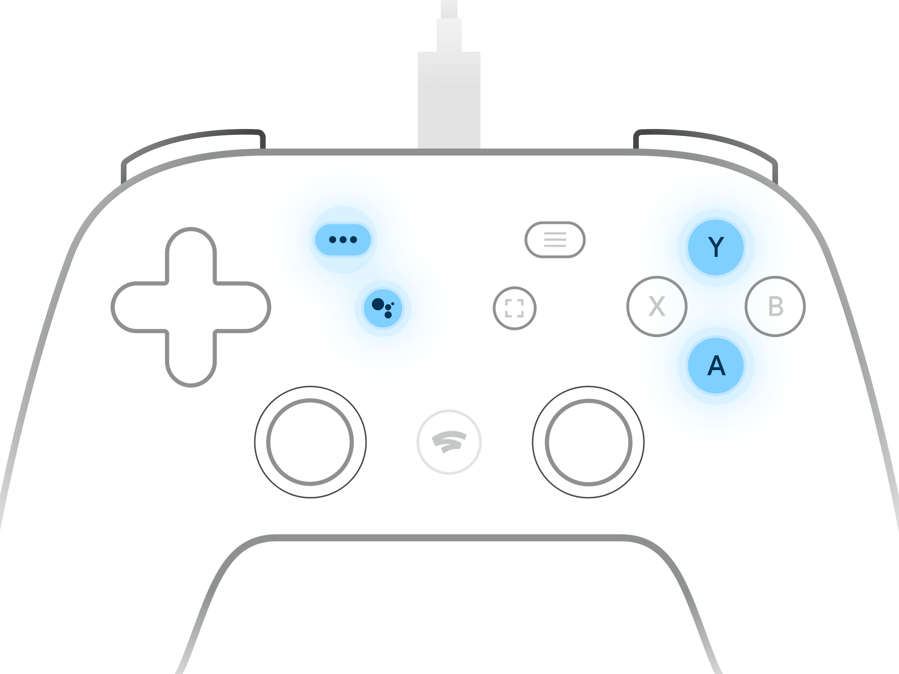

# Stadia 手柄：刷成 Xbox 手柄的自定义固件

给 Google Stadia 手柄换一套自编固件，让 Windows 直接把它当 Xbox 手柄用，同时修掉原厂的问题。

## 特性

| 特性 | 说明 |
|---|---|
| **Xbox 兼容** | 有线走 XUSB（`045E:028E`），蓝牙走 Xbox Series HID。Windows 自带驱动直接认，无需第三方驱动或 Steam Input。按键、摇杆、扳机、双马达沿用原厂采样。 |
| **蓝牙震动修复** | 原厂固件蓝牙下完全无震动（Windows / Android / iOS 都一样）。修复后无线震动恢复，与有线一致。 |
| **1000Hz 回报率** | 有线可切 250 / 500 / 1000 Hz，`Stadia + 方向键上/下` 切换，震动强弱提示档位，关机后保留。 |

前提：PVT 量产机，序列号非 `91`–`94` 开头。刷写会永久烧掉签名熔丝，不可逆；原厂固件可随时刷回。

## 原理

### 1. 原厂蓝牙为什么不震动

震动通路本身没问题——有线和蓝牙最终都调用同一个马达处理函数。问题在固件公布的特征属性：震动输出特征（UUID `0x2A4D`，报告 ID 5）的属性字节是 `0x0A`，即「可读 + 可带响应写入」，缺 **Write Without Response**（`0x04`）。Windows 蓝牙下 `hid_write()` 走的正是无响应写入，报告在主机侧被退回，马达不响。

修复只改一个字节：`0xCB28C` 由 `0x0A` 改为 `0x0E`。不改指令、不重编译，原注册代码读到该字节就会多声明一个属性位。

### 2. 自定义固件怎么刷进去

芯片是 i.MX RT1060，HAB 安全启动只接受 RSA-4096 签名镜像，自编固件写进去也起不来，要先过两关。

**解除签名校验。** SDP 串行下载模式在 HAB 关闭时仍可用，其 USB HID 回调按 `+3` 偏移写报告缓冲区，溢出的 3 字节正好覆盖相邻的 SDP 设备结构指针。借此可在 BootROM 退出前执行未签名代码；永久模式直接烧 `FIELD_RETURN` eFuse，芯片进入 field return 状态，可启动任意未签名镜像。

**写入 Flash。** 用官方 `restricted_ivt_flashloader.bin` 进入 Flashloader，回读 MCU 与 Flash 型号（`17c8` Giga / `17ef` Winbond）选对应 FlexSPI 配置，按 16 KB 扇区擦除后写入 Application A（`0x60040000`），复位启动。

### 3. Xbox 与 1000Hz 怎么实现

不重写整机固件。采样、摇杆校准、马达驱动全部保留，只换对外协议层。

- **USB**：公布 Xbox 360 标识，仍用原端点 `0x83` / `0x03`，把 11 字节 HID 报告编码为 20 字节 XUSB 报告；震动命令回译为报告 ID 5。
- **蓝牙**：换 Xbox Series 的 283 字节 Report Map 与 PnP ID，输入 16 字节、输出 8 字节，同样回译给原厂马达函数。
- **1000Hz**：硬件本身就支持。原厂只是把输入端点 `bInterval` 设为 6（高速 USB 下 4 ms，即 250 Hz）。把 `bInterval` 调小、同时把输入采样周期改为 2 ms 或 1 ms，两者对齐即可。

---

# 操作

环境：Linux，命令按 Ubuntu/Debian 写，其他发行版换包管理器。

## 1. 安装依赖

```bash
sudo apt install -y python3 python3-venv python3-pip build-essential pkg-config libudev-dev libusb-1.0-0
```

两个工具各建虚拟环境。

**签名绕过工具**

```bash
cd nxp-sdp-overrun
python3 -m venv .venv
.venv/bin/pip install hidapi keystone-engine
```

装了 `uv` 可跳过这三步，后面用 `sudo uv run main.py --permanent`。

**刷写工具**

```bash
cd ../StadiaController-main/stadiatool
python3 -m venv .venv
.venv/bin/pip install pyusb
```

`pyusb` 依赖系统的 `libusb-1.0.so.0`，上面已装。

## 2. 权限

访问 USB 设备要 root，后面命令统一加 `sudo`。

`nxp-sdp-overrun` 通过 hidraw 打开设备，`stadiatool` 通过 pyusb 做控制传输和端点读写，都需要写 `/dev` 下的设备节点。

`sudo` 会清掉环境变量，**不要写 `sudo python`**（会用系统 python，找不到刚装的依赖），要直接调用虚拟环境解释器：

```bash
sudo .venv/bin/python xxx.py
```

嫌麻烦可以自己配 udev 规则放开这几个 VID 的权限；不配也能走完全程。

## 3. 确认手柄状态（可选）

正常插线、不按键，手柄枚举为 `18d1:9400`：

```bash
cd StadiaController-main/stadiatool
sudo .venv/bin/python stadiatool.py info
```

输出序列号、DVT/PVT 判定、固件版本和电量。序列号 `91`–`94` 开头的话到此为止。

## 4. 进入 SDP 模式

分两步，顺序不能颠倒。

**第一步：按住菜单键不放，同时把 USB 线插上。**


**第二步：松开菜单键，把下面四个键同时按一下。**

菜单键（`···`，靠近十字键的椭圆键）、助理键（圆形，四色点）、`A`、`Y`。



此时已进入 SDP 模式，确认：

```bash
lsusb | grep 1fc9
```

看到 `1fc9:0135` 就对了，`lsusb` 显示 `NXP Semiconductors SP Blank RT Family`：

```
Bus 003 Device 008: ID 1fc9:0135 NXP Semiconductors SP Blank RT Family
```

SDP 模式保持到断电，中途拔线重插不用重按。

## 5. 永久解开签名校验

```bash
cd ../nxp-sdp-overrun
sudo .venv/bin/python main.py --permanent
```

程序打印 `THIS ACTION IS IRREVERSIBLE...`，输入大写 `REOPEN` 回车。

成功输出：

```
Writing payload...
Exploit written. "FR Blank RT Family" USB product string means success.
```

确认产品名已变：

```bash
lsusb -v -d 1fc9:0135 2>/dev/null | grep -i -E 'iProduct|FR Blank'
```

`SP Blank` → `FR Blank` 即成功，芯片进入 field return 状态。

**不可逆。** eFuse 烧掉无法恢复，但原厂签名镜像照常启动，随时可刷回官方固件。

## 6. 刷入 Xbox 固件

**不要拔线、不要断电**，在同一 SDP 会话继续。

```bash
cd ../StadiaController-main/stadiatool

# 送 flashloader 进芯片，手柄重新枚举为 15a2:0073
sudo .venv/bin/python stadiatool.py flashloader

# 擦除并写入固件
sudo .venv/bin/python stadiatool.py flash_firmware data/bruce_pvt_xbox.EXPERIMENTAL-INVALID-SIGNATURE.bin
```

`flashloader` 成功标志：

```
flashloader image is 100672 bytes
SDP load result: 0x00000000
```

`SDP load result` 非 `0x00000000` 即失败，不要继续刷。

`flash_firmware` 完整输出：

```
Detecting MCU type...
MCU: 6c0000 (106XA0)
Detecting Flash type...
Flash: 17ef (Winbond-16m)
Setting up flash
Clearing GPR flags
Flashing to Application A at 0x60040000...
Resetting device
Done!
```

Flash 为 `17c8`（Giga）或 `17ef`（Winbond）都正常，工具自动选 FCB 配置。

完成后手柄自动复位。拔线重插。

## 7. 验证

**有线**

```bash
lsusb | grep 045e
```

应显示 `045e:028e Microsoft Corp. Xbox 360 Controller`。固件面向 Windows XInput，最终验收在 Windows：设备管理器出现「Xbox 360 控制器」，`joy.cpl` 中按键与双马达正常，游戏无需 Steam Input 即可识别。

**蓝牙**

必须先删除旧配对，否则沿用缓存的 Stadia 配置：

1. 系统蓝牙设置中删除 `Stadia Controller`
2. 手柄按住 Stadia 键进配对模式，重新配对
3. 配对后设备名为 `Xbox Wireless Controller`

不删旧配对的表现：能连上但按键错乱、震动失效。

## 8. 日常使用

| 组合键 | 作用 |
|---|---|
| `Stadia + 方向键上/下` | USB 回报率 250 / 500 / 1000 Hz，震动强弱提示 |

档位写入设置区，关机后保留。

## 9. 回滚

流程同上，只换文件名：

```bash
sudo .venv/bin/python stadiatool.py flash_firmware data/bruce_pvt_a_prod_signed.bin
```

eFuse 已烧也不影响启动。

---

## 出问题怎么办

| 现象 | 处理 |
|---|---|
| 找不到 `1fc9:0135` | 菜单键没按住就插线、四键没同时按、或线只能充电；拔线从头重来 |
| `PermissionError` / `open failed` | 忘了加 sudo |
| 加了 sudo 报 `ModuleNotFoundError` | 写成了 `sudo python`，改为 `sudo .venv/bin/python` |
| `Device not in OEM mode` | 手柄处于 SDP 模式，先断电回正常模式 |
| `Not in SDP mode` | 上一步解锁后设备已复位，重新按四键进 SDP |
| `Not in flashloader` | 漏了 `flashloader` 步骤，或中途设备重置 |
| 刷完不识别 | 拔线等 5 秒再插；换 USB 口和线；确认刷的是 `bruce_pvt_xbox` |
| 蓝牙连上没反应 | 删旧配对重新配对 |

## 相关文件

| 路径 | 说明 |
|---|---|
| `src/` | 固件可编译源码，见 `src/README.md` |
| `img/` | 教程配图与视频封面 |
| `nxp-sdp-overrun/` | HAB 绕过工具（SDP 缓冲区溢出） |
| `StadiaController-main/stadiatool/` | 刷写工具，`data/` 为固件与 flashloader |
